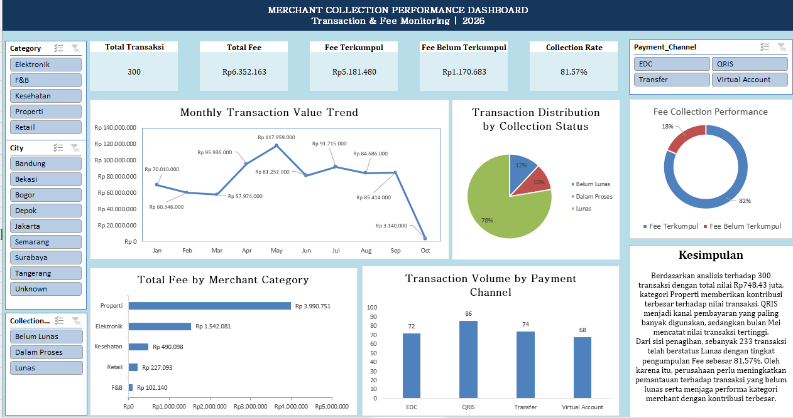

# Merchant Collection Performance Dashboard
### Transaction & Fee Monitoring | 2026

## 1. Project Overview

**Merchant Collection Performance Dashboard** merupakan proyek analisis data untuk memantau nilai transaksi merchant, kontribusi Fee, penggunaan kanal pembayaran, serta performa pengumpulan Fee menggunakan Microsoft Excel.

Proyek ini mencakup data understanding, data cleaning, data processing, analisis menggunakan PivotTable, visualisasi, dan pembuatan dashboard interaktif dengan Slicer.

> **Dataset Note:** Dataset yang digunakan merupakan data simulasi untuk kebutuhan latihan dan portofolio, bukan data operasional BCA atau institusi keuangan lainnya.

---

## 2. Dataset Overview — Column Description

Dataset terdiri dari **13 kolom** yang mencakup informasi transaksi, merchant, pembayaran, dan pengumpulan Fee.

| No. | Column Name | Description |
|---:|---|---|
| 1 | `Transaction_ID` | ID unik untuk mengidentifikasi setiap transaksi. Digunakan untuk menghitung jumlah transaksi dan memeriksa data duplikat. |
| 2 | `Transaction_Date` | Tanggal transaksi dilakukan. Digunakan untuk menganalisis tren transaksi berdasarkan hari, bulan, atau periode tertentu. |
| 3 | `Merchant_ID` | Kode unik merchant yang melakukan transaksi. Digunakan untuk membedakan setiap merchant. |
| 4 | `Merchant_Name` | Nama merchant yang terkait dengan transaksi. Digunakan untuk mengenali merchant dan melakukan analisis berdasarkan merchant. |
| 5 | `Category` | Kategori atau jenis usaha merchant, seperti Properti, Elektronik, Kesehatan, Retail, dan F&B. Digunakan untuk membandingkan kontribusi transaksi antar kategori. |
| 6 | `City` | Kota tempat merchant berada. Digunakan untuk menganalisis persebaran transaksi berdasarkan lokasi. |
| 7 | `Payment_Channel` | Kanal pembayaran yang digunakan, seperti QRIS, EDC, Transfer, dan Virtual Account. Digunakan untuk menganalisis penggunaan kanal pembayaran. |
| 8 | `Transaction_Amount_Rp` | Nilai transaksi dalam Rupiah. Digunakan untuk menghitung total dan rata-rata nilai transaksi serta membandingkan performa transaksi. |
| 9 | `Fee_Rate` | Persentase tarif Fee yang diterapkan pada transaksi. Digunakan sebagai dasar perhitungan Fee. |
| 10 | `Fee_Amount_Rp` | Nominal Fee dalam Rupiah yang dihitung dari transaksi. Digunakan untuk menganalisis total Fee. |
| 11 | `Collection_Status` | Status pengumpulan Fee, yaitu Lunas, Belum Lunas, atau Dalam Proses. Digunakan untuk memantau status penagihan. |
| 12 | `Due_Date` | Tanggal jatuh tempo pengumpulan Fee. Digunakan untuk membantu pemantauan jadwal dan tindak lanjut penagihan. |
| 13 | `Collected_Amount_Rp` | Nominal Fee yang telah terkumpul dalam Rupiah. Digunakan untuk membandingkan nominal terkumpul dengan total Fee dan menghitung Collection Rate. |

### Column Grouping

Untuk mempermudah proses analisis, kolom dataset dapat dikelompokkan menjadi empat bagian:

**1. Transaction Information**
- `Transaction_ID`
- `Transaction_Date`
- `Transaction_Amount_Rp`

**2. Merchant Information**
- `Merchant_ID`
- `Merchant_Name`
- `Category`
- `City`

**3. Payment Information**
- `Payment_Channel`

**4. Fee and Collection Information**
- `Fee_Rate`
- `Fee_Amount_Rp`
- `Collection_Status`
- `Due_Date`
- `Collected_Amount_Rp`

---

## 3. Project Background — STAR Method

### S — Situation

Data transaksi dalam bentuk tabel belum secara langsung memberikan gambaran ringkas mengenai tren transaksi, kontribusi kategori merchant, kanal pembayaran yang digunakan, dan status pengumpulan Fee.

Oleh karena itu, diperlukan proses pengolahan dan analisis data untuk mengubah data transaksi menjadi informasi yang lebih mudah dipahami dan digunakan dalam pemantauan bisnis.

### T — Task

Saya bertanggung jawab mengolah dataset transaksi merchant dan membangun dashboard untuk memantau performa transaksi serta pengumpulan Fee.

Analisis difokuskan pada lima pertanyaan utama:

**1. Bulan mana yang memiliki nilai transaksi tertinggi?**

Mengidentifikasi bulan dengan total nilai transaksi terbesar untuk mengetahui periode dengan aktivitas transaksi tertinggi.

**2. Kategori merchant mana yang memberikan kontribusi nilai transaksi terbesar?**

Membandingkan nilai transaksi berdasarkan kategori merchant untuk mengetahui kategori dengan kontribusi terbesar.

**3. Kanal pembayaran apa yang paling banyak digunakan?**

Menghitung jumlah transaksi berdasarkan Payment Channel untuk mengetahui kanal pembayaran yang paling sering digunakan.

**4. Berapa total Fee yang belum tertagih dan berapa transaksi yang belum lunas atau masih dalam proses?**

Menganalisis Collection Status serta membandingkan total Fee dengan nominal yang sudah terkumpul.

**5. Apa rekomendasi yang dapat diberikan berdasarkan temuan data?**

Menyusun rekomendasi berdasarkan hasil analisis untuk mendukung pemantauan transaksi dan proses penagihan.

### A — Action

#### 1. Data Understanding

Melakukan pemeriksaan awal untuk memahami struktur dan karakteristik dataset.

- 300 transaksi setelah proses penghapusan duplikasi.
- 13 kolom data transaksi.
- Periode transaksi Januari–Oktober 2026.
- Mencakup informasi merchant, kategori, kota, kanal pembayaran, nilai transaksi, Fee, dan status penagihan.

#### 2. Data Cleaning

Melakukan pembersihan data menggunakan Microsoft Excel:

- Memeriksa dan menghapus satu baris transaksi duplikat dengan Transaction ID `TRX0072`.
- Mengidentifikasi tiga nilai kosong pada kolom `City` dan mengisinya dengan `Unknown`.
- Mengidentifikasi dua nilai kosong pada `Transaction_Amount_Rp`.
- Memperkirakan nilai transaksi yang kosong menggunakan rumus `Fee_Amount_Rp / Fee_Rate`, dengan asumsi hubungan perhitungan Fee tersebut berlaku.
- Memeriksa dua transaksi berstatus `Belum Lunas` yang sudah memiliki nominal `Collected Amount`. Data dipertahankan untuk pemeriksaan lebih lanjut, bukan langsung dianggap sebagai kesalahan.

#### 3. Data Processing and Analysis

Menggunakan PivotTable untuk mengolah dan menganalisis data berdasarkan beberapa dimensi:

- Total nilai transaksi berdasarkan bulan.
- Total nilai transaksi berdasarkan kategori merchant.
- Jumlah transaksi berdasarkan kanal pembayaran.
- Jumlah transaksi berdasarkan Collection Status.
- Total Fee dan Collected Amount untuk mengukur performa pengumpulan Fee.

#### 4. Dashboard Development

Membangun dashboard menggunakan Microsoft Excel dengan komponen berikut.

**KPI Cards**
- Total Transactions
- Total Fee
- Fee Collected
- Fee Not Yet Collected
- Collection Rate

**Data Visualizations**
- Monthly Transaction Value Trend — Line Chart.
- Transaction Distribution by Collection Status — Pie Chart.
- Fee Collection Performance — Doughnut Chart.
- Total Fee by Merchant Category — Horizontal Bar Chart.
- Transaction Volume by Payment Channel — Column Chart.

**Interactive Filters**
- Category
- City
- Collection Status
- Payment Channel

Slicer digunakan untuk membantu pengguna memfilter informasi berdasarkan kategori, kota, status penagihan, dan kanal pembayaran.

### R — Result

Berdasarkan pengolahan dan analisis terhadap 300 transaksi, diperoleh hasil sebagai berikut.

#### 1. Key Performance Indicators

| KPI | Result |
|---|---:|
| Total Transactions | 300 |
| Total Transaction Value | Rp748.430.000 |
| Total Fee | Rp6.352.163 |
| Fee Collected | Rp5.181.480 |
| Fee Not Yet Collected | Rp1.170.683 |
| Collection Rate | 81,57% |

#### 2. Monthly Transaction Analysis

Bulan Mei mencatat nilai transaksi tertinggi sebesar **Rp117.959.000**.

Sementara itu, Oktober memiliki nilai transaksi terendah sebesar **Rp3.140.000**. Nilai Oktober perlu ditinjau dengan mempertimbangkan kelengkapan periode datanya.

#### 3. Merchant Category Analysis

| Merchant Category | Transaction Value |
|---|---:|
| Properti | Rp479.383.000 |
| Elektronik | Rp174.258.000 |
| Kesehatan | Rp57.183.000 |
| Retail | Rp25.271.000 |
| F&B | Rp12.335.000 |

Kategori Properti menyumbang sekitar **64,04%** dari total nilai transaksi. Jika digabungkan dengan Elektronik, kedua kategori tersebut berkontribusi sekitar **87,32%**.

#### 4. Payment Channel Analysis

| Payment Channel | Transaction Count |
|---|---:|
| QRIS | 86 |
| Transfer | 74 |
| EDC | 72 |
| Virtual Account | 68 |
| **Total** | **300** |

QRIS merupakan kanal pembayaran dengan jumlah transaksi terbanyak, yaitu 86 transaksi atau sekitar **28,67%** dari keseluruhan transaksi.

#### 5. Collection Status Analysis

| Collection Status | Transaction Count |
|---|---:|
| Lunas | 233 |
| Belum Lunas | 36 |
| Dalam Proses | 31 |
| **Total** | **300** |

Sebanyak 233 transaksi atau 77,67% berstatus Lunas. Sementara itu, terdapat 67 transaksi yang belum berstatus Lunas.

#### 6. Fee Collection Analysis

Dari total Fee sebesar Rp6.352.163, nominal yang sudah terkumpul mencapai Rp5.181.480.

- Fee Collected: Rp5.181.480 (81,57%).
- Fee Not Yet Collected: Rp1.170.683 (18,43%).

#### 7. Business Recommendations

**Recommendation 1 — Improve Collection Monitoring**

Memprioritaskan pemantauan terhadap 67 transaksi yang belum berstatus Lunas dengan memperhatikan tanggal jatuh tempo dan nominal Fee. Langkah ini dapat membantu proses tindak lanjut penagihan.

**Recommendation 2 — Monitor Key Merchant Categories**

Memberikan perhatian lebih terhadap kategori Properti dan Elektronik karena kedua kategori tersebut menyumbang sekitar 87,32% dari total nilai transaksi. Pemantauan berkala dapat membantu memahami perkembangan kontribusi kedua kategori tersebut.

---

## 4. Tools & Skills

**Tools**
- Microsoft Excel
- PivotTable
- PivotChart
- Excel Slicer
- Excel Formulas

**Technical Skills**
- Data Cleaning
- Data Processing
- Data Validation
- Exploratory Data Analysis
- Data Aggregation
- Data Visualization
- Dashboard Development
- Business Insight & Reporting

---

## 5. Dashboard Preview


```

---

## 6. Key Takeaways

Melalui proyek ini, saya memperoleh pengalaman dalam mengolah data transaksi menggunakan Microsoft Excel, melakukan analisis berdasarkan beberapa dimensi bisnis, serta menyajikan hasil analisis melalui dashboard interaktif.

Proyek ini membantu saya memahami bagaimana data transaksi dapat digunakan untuk memantau performa merchant, penggunaan kanal pembayaran, dan proses pengumpulan Fee.

**Project Focus:** Data Analytics | Business Intelligence | Excel Dashboard

---

## 7. Repository Note

Dataset pada proyek ini merupakan data simulasi untuk latihan dan portofolio. Seluruh hasil analisis dan rekomendasi hanya berlaku untuk dataset tersebut dan tidak merepresentasikan kinerja atau proses operasional institusi keuangan tertentu.

Merchant Collection Performance Dashboard

Transaction & Fee Monitoring | 2026

Project Overview

Proyek analisis data menggunakan Microsoft Excel untuk memantau transaksi merchant dan performa pengumpulan Fee. Dataset yang digunakan merupakan data simulasi dengan 300 transaksi dan 13 kolom.

Dataset Columns

Column

Description

Transaction_ID

ID unik transaksi

Transaction_Date

Tanggal transaksi

Merchant_ID

ID merchant

Merchant_Name

Nama merchant

Category

Kategori usaha merchant

City

Kota merchant

Payment_Channel

Kanal pembayaran

Transaction_Amount_Rp

Nilai transaksi

Fee_Rate

Persentase tarif Fee

Fee_Amount_Rp

Nominal Fee

Collection_Status

Status pengumpulan Fee

Due_Date

Tanggal jatuh tempo

Collected_Amount_Rp

Nominal Fee terkumpul

Project Background — STAR Method

S — Situation

Data transaksi merchant perlu dianalisis agar informasi mengenai nilai transaksi, kategori merchant, kanal pembayaran, dan pengumpulan Fee lebih mudah dipantau.

T — Task

Mengolah data transaksi dan membuat dashboard untuk menjawab lima pertanyaan:

Bulan dengan nilai transaksi tertinggi.

Kategori merchant dengan kontribusi transaksi terbesar.

Kanal pembayaran yang paling banyak digunakan.

Total Fee yang belum terkumpul dan jumlah transaksi yang belum lunas atau dalam proses.

Rekomendasi berdasarkan hasil analisis.

A — Action

Melakukan data cleaning untuk menangani duplikasi dan nilai kosong.

Mengolah data menggunakan PivotTable.

Membuat grafik menggunakan PivotChart.

Menyusun dashboard dengan KPI dan Slicer interaktif.

Menganalisis tren transaksi, kategori merchant, kanal pembayaran, dan status pengumpulan Fee.

R — Result

Hasil analisis dari 300 transaksi:

Metric

Result

Total Transaction Value

Rp748.430.000

Total Fee

Rp6.352.163

Fee Collected

Rp5.181.480

Fee Not Yet Collected

Rp1.170.683

Collection Rate

81,57%

Key Findings:

Mei menjadi bulan dengan nilai transaksi tertinggi sebesar Rp117.959.000.

Properti menjadi kategori dengan kontribusi transaksi terbesar, sekitar 64,04%.

QRIS menjadi kanal pembayaran terbanyak dengan 86 transaksi.

Sebanyak 233 transaksi berstatus Lunas dan 67 transaksi belum berstatus Lunas.

Recommendations:

Meningkatkan pemantauan transaksi yang belum berstatus Lunas berdasarkan nominal Fee dan tanggal jatuh tempo.

Memantau kategori Properti dan Elektronik karena memberikan kontribusi sekitar 87,32% dari total nilai transaksi.

Dashboard Preview


Tools & Skills

Tools: Microsoft Excel, PivotTable, PivotChart, Excel Slicer.

Skills: Data Cleaning, Data Processing, Data Analysis, Data Visualization, Dashboard Development.

Note: Dataset merupakan data simulasi untuk kebutuhan latihan dan portofolio, bukan data operasional perusahaan atau institusi keuangan tertentu.
